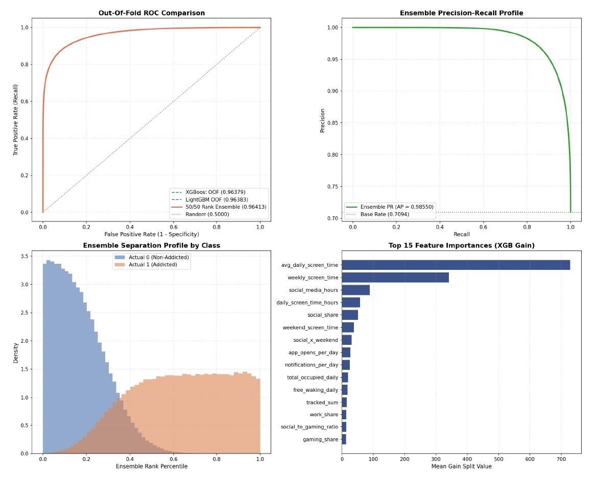

# Predicting Smartphone Addiction — Kaggle Playground Series S6E8

End-to-end tabular machine learning pipeline for [Kaggle Playground Series — Season 6, Episode 8](https://www.kaggle.com/competitions/playground-series-s6e8), predicting binary smartphone addiction risk (`addicted_label`) evaluated on **ROC-AUC**.

## Key Results

| Component | Details |
| :--- | :--- |
| **Validation Strategy** | Stratified K-Fold Cross-Validation (shared leak-free splits across encoding & modeling) |
| **Feature Engineering** | 39 engineered features + Bayesian-smoothed Out-Of-Fold (OOF) Target Encoding |
| **Models** | Histogram-based **XGBoost** + **LightGBM** (native `NaN` handling) |
| **Ensembling** | 50/50 Percentile Rank Averaging |
| **OOF ROC-AUC** | **0.96413** |

## Approach & Pipeline Highlights

1. **Leak-Free Feature Engineering:** Created behavioral and screen-time interaction features while preserving native `NaN` values for tree splits. Applied Bayesian-smoothed OOF Target Encoding strictly inside each training fold to eliminate target leakage.
2. **Gradient Boosted Decision Trees:** Trained tuned XGBoost and LightGBM classifiers across identical stratified folds for direct out-of-fold comparison.
3. **Rank-Based Ensembling:** Combined model predictions via percentile rank averaging (`0.50 * XGB + 0.50 * LGBM`) to optimize ROC-AUC stability across calibration differences.
4. **Automated Diagnostics:** Outputs a 2×2 evaluation dashboard covering ROC curves, Precision-Recall curves, predicted probability separation, and top-15 feature importances.

## Visual Diagnostics



## How to Run

1. **Clone the repository:**
   ```bash
   git clone [https://github.com/Adibshaikh2209/kaggle-s6e8-smartphone-addiction.git](https://github.com/Adibshaikh2209/kaggle-s6e8-smartphone-addiction.git)
   cd kaggle-s6e8-smartphone-addiction
   ```

2. **Install dependencies:**
   ```bash
   pip install numpy pandas scikit-learn xgboost lightgbm matplotlib seaborn jupyter
   ```

3. **Download competition data & run:**
   Place `train.csv`, `test.csv`, and `sample_submission.csv` from Kaggle into a `data/` directory (or run directly in a Kaggle Notebook), then open and run all cells in the `.ipynb` notebook.

## License

This project is licensed under the [MIT License](LICENSE).
